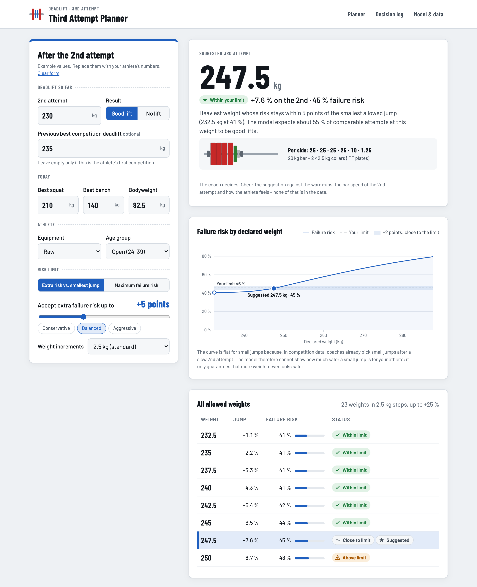
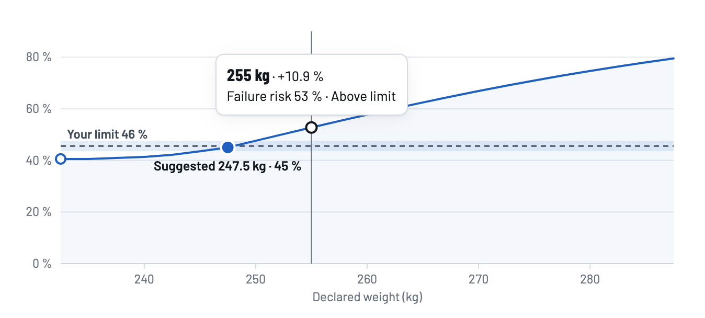
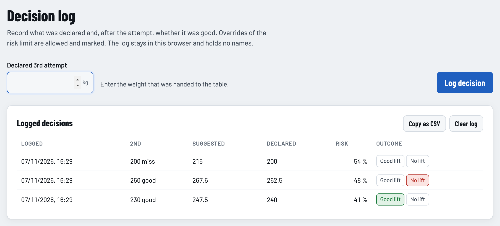
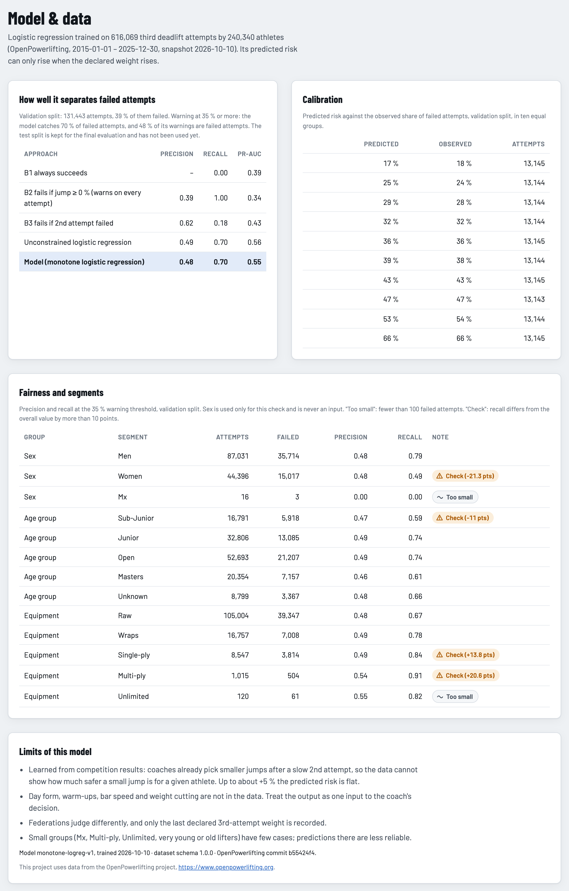
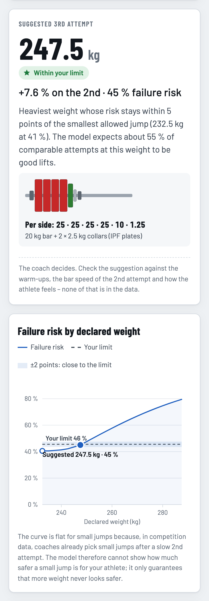

# Third Attempt Planner – risk of failing the 3rd deadlift attempt

[](https://github.com/patrick-morgenegg/aiml/actions/workflows/ci.yml)


After the 2nd deadlift attempt a coach must declare the weight of the 3rd. This project estimates the
probability that the 3rd attempt **fails** for a planned weight (binary classification), using public
competition data from [OpenPowerlifting](https://www.openpowerlifting.org) (Public Domain).

KETE AI/ML course project · Patrick Morgenegg, Niklas Grün · Prof. Dr. U. Michelucci

<picture>
  <source media="(prefers-color-scheme: dark)" srcset="docs/screenshots/planner-dark.png">
  
</picture>

## Contents

- [Try the app](#try-the-app)
- [What the app does](#what-the-app-does)
- [Model and results](#model-and-results)
- [Rebuild the data and the model](#rebuild-the-data-and-the-model)
- [Repository layout](#repository-layout)
- [Skills for AI-assisted coding](#skills-for-ai-assisted-coding)
- [Data attribution](#data-attribution)

## Try the app

Open [`app/index.html`](app/index.html) in a browser. There is nothing to install and no server: everything runs
in the browser and nothing you enter leaves the device. Other ways to run it are in the [app README](app/README.md).

## What the app does

You enter the situation after the 2nd attempt: its weight and result, the best squat and bench of the day,
bodyweight, equipment, age group and, optionally, the previous best competition deadlift. The app then:

1. **Suggests the heaviest weight within your risk limit**, with the IPF plate loading per side. Set the limit
   as extra risk over the smallest allowed jump or as a maximum failure risk.
2. **Shows the failure risk for every allowed weight** as a curve and a table. The model is constrained so that
   more weight never looks safer, and weights within ±2 points of your limit are marked as *close to the limit*.

   

3. **Keeps a decision log** of what was declared and how the attempt went. Declarations above the limit are
   marked as overrides. The log stays in the browser, holds no names and can be copied as CSV.

   

4. **Explains the model**: metrics against simple baselines, calibration, precision and recall per segment
   (fairness) and its limits.

   <details>
   <summary>Screenshot of the <em>Model &amp; data</em> section</summary>

   

   </details>

It works on phones and has a dark theme:



The screenshots use the example values the app ships with. To refresh them after a change to the app, run
[`scripts/capture_screenshots.mjs`](scripts/capture_screenshots.mjs).

## Model and results

Dataset (snapshot 2026-10-10, period 2015–2025):

| | |
|---|---|
| Records (one per lifter and meet) | 879,465 |
| Athletes | 343,047 |
| Failed 3rd attempts | 38.7 % |
| Split (athletes) | train 70 % · validation 15 % · test 15 % – grouped by athlete |

Current numbers and the full cleaning funnel: [`data/processed/metadata.json`](data/processed/metadata.json).

Model (validation split): a monotone logistic regression reaches a PR-AUC of 0.55, against a base rate of 0.39
and 0.43 for the rule "fails if the 2nd attempt failed". It catches 70 % of failed attempts at 48 % precision, is
well calibrated, and its risk is constrained to rise with weight. The test split has not been used yet. Details:
[docs/specs/07-evaluation-and-fairness.md](docs/specs/07-evaluation-and-fairness.md).

> [!NOTE]
> The app supports the coach's decision; it does not make it. Day form, warm-ups, bar speed and weight cutting
> are not in the data. At the same threshold, recall is lower for women (0.49) than for men (0.79).

## Rebuild the data and the model

CI runs with Python 3.12 and Node 22.

```bash
pip install -r requirements.txt
jupyter nbconvert --to notebook --execute --inplace \
  --ExecutePreprocessor.timeout=3600 notebooks/01_data_extraction_and_cleaning.ipynb
python scripts/validate_dataset.py data/processed/deadlift3_attempts.parquet --metadata data/processed/metadata.json
jupyter nbconvert --to notebook --execute --inplace notebooks/02_model_training.ipynb   # retrain the app model
node --test "app/tests/*.test.js"                                                         # app tests
```

Or open the notebooks in Jupyter and *Run All*. The first run downloads ~170 MB. If the download host is blocked
in your network, see *Option B* in [docs/specs/02-data-source.md](docs/specs/02-data-source.md).

For app work you do not need the full dataset: the 5,000-row sample in `data/sample/` is enough.

## Repository layout

```
notebooks/01_data_extraction_and_cleaning.ipynb   extract → clean → features → pseudonymise → split → export
notebooks/02_model_training.ipynb                  monotone logistic regression → app/model/model.json
app/                                               Third Attempt Planner (static HTML + JS, works from disk)
scripts/validate_dataset.py                        checks any export against the dataset contract
scripts/capture_screenshots.mjs                    regenerates the screenshots in docs/screenshots/
data/raw/                                          downloaded OpenPowerlifting zip (git-ignored)
data/processed/                                    full Parquet/CSV (git-ignored) + metadata.json (in git)
data/sample/deadlift3_attempts_sample.csv          5,000-row sample for app development and tests (in git)
docs/                                              specs, dataset schema, decision log  → start at docs/README.md
.claude/skills/                                    project skills for AI-assisted ("vibe") coding
CLAUDE.md                                          instructions for coding agents
```

The specs in [`docs/`](docs/README.md) explain the data contract, leakage rules, split and evaluation;
[`docs/decisions.md`](docs/decisions.md) records why things are the way they are.

## Skills for AI-assisted coding

| Skill | Use it to |
|---|---|
| [`refresh-dataset`](.claude/skills/refresh-dataset/SKILL.md) | rebuild and validate the dataset (fresh clone, new snapshot, rule change) |
| [`dataset-contract`](.claude/skills/dataset-contract/SKILL.md) | load the data correctly, pick features from the schema, respect the split |
| [`leakage-check`](.claude/skills/leakage-check/SKILL.md) | review a new feature, input field or processing step for leakage |
| [`coach-app`](.claude/skills/coach-app/SKILL.md) | change or review the Third Attempt Planner in `app/` against spec 08 |

In Claude Code they load automatically when relevant, or call them as `/refresh-dataset` etc.

## Data attribution

This project uses data from the OpenPowerlifting project, https://www.openpowerlifting.org.
You may download a copy of the data at https://gitlab.com/openpowerlifting/opl-data.
